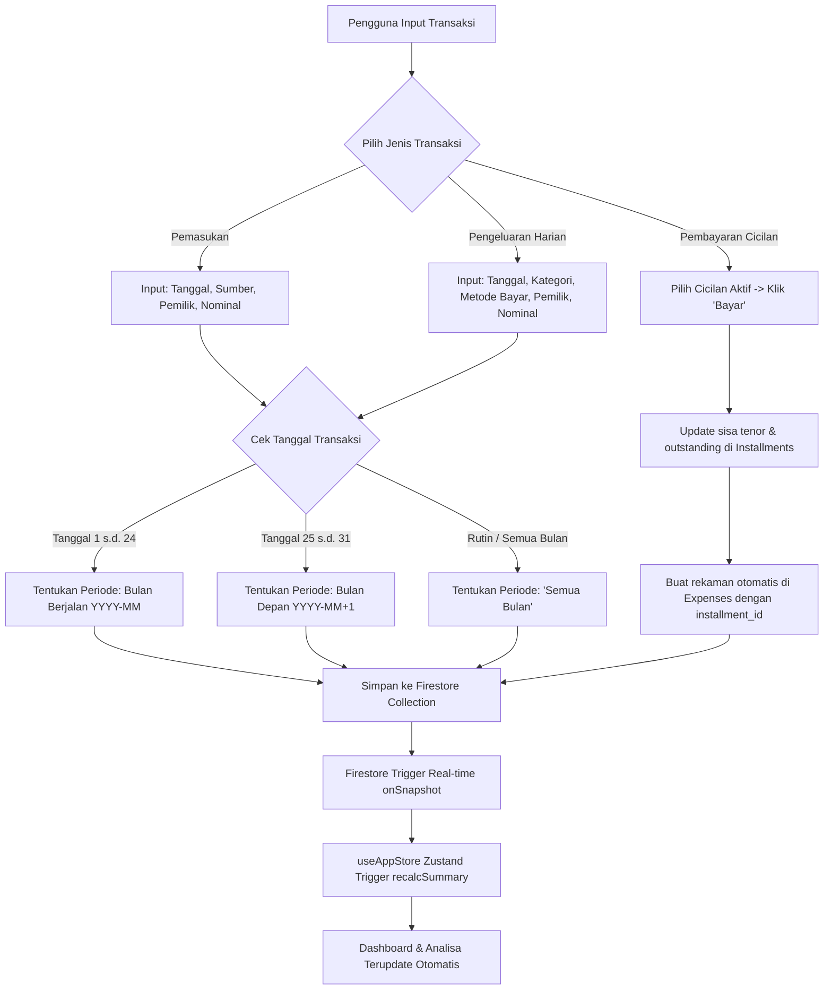
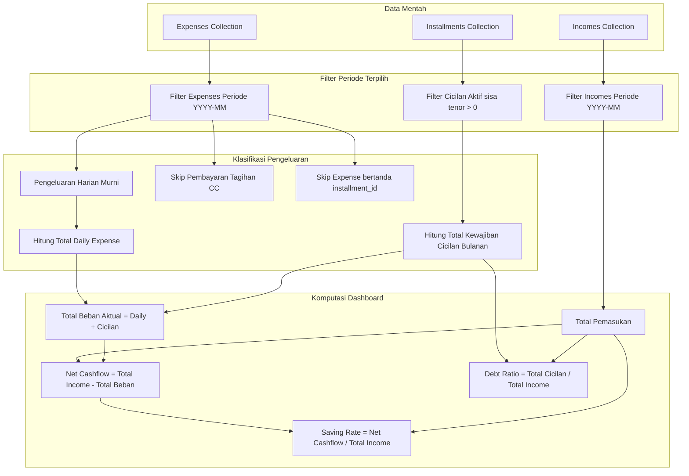

# DOKUMENTASI TEKNIS & SPESIFIKASI FITUR APLIKASI CASHFLOW

Dokumen ini dirancang sebagai acuan arsitektur sistem, aturan bisnis, dan alur kerja (flowchart) aplikasi **Cashflow (Family Finance Management System)**. Dokumen ini dapat disalin secara utuh ke LLM (seperti ChatGPT atau Claude) untuk proses *review*, perancangan fitur baru, atau penyesuaian aturan pencatatan keuangan.

---

## 1. Ringkasan Eksekutif & Karakteristik Aplikasi
* **Nama Projek**: Cashflow (Family & Personal Finance Web App)
* **Tujuan**: Aplikasi pencatatan dan pengelolaan arus kas keluarga/pasangan secara real-time, offline-first ready, dengan pemisahan kepemilikan dana, manajemen cicilan utang, serta analisa tren kesehatan finansial bulanan.
* **Tech Stack**:
  * **Frontend**: React 19 (TypeScript), Vite 8, React Router DOM v7
  * **State Management**: Zustand v5
  * **Database & Auth**: Firebase Firestore (Realtime `onSnapshot`) + Firebase Authentication (Google Auth dengan Whitelist Email)
  * **Offline/Local Cache**: Dexie.js (IndexedDB `FamilyFinanceDB`)
  * **Visualisasi & Grafik**: Recharts
  * **Styling**: Vanilla CSS Modular (Dark / Light theme support)

---

## 2. Aturan Bisnis Kunci (Core Business Rules)

### A. Cutoff Siklus Finansial (Siklus Gajian Tanggal 25)
* Aplikasi menggunakan tanggal cutoff **25** untuk menentukan periode bulan finansial:
  * **Tanggal 1 s.d. 24**: Masuk ke dalam periode bulan berjalan (`YYYY-MM`).
  * **Tanggal 25 s.d. 31**: Masuk ke dalam periode **bulan berikutnya** (`YYYY-(MM+1)`), karena diasumsikan merupakan alokasi gaji untuk bulan mendatang.
  * **Tag 'Semua Bulan'**: Untuk transaksi rutin yang berlaku di setiap periode filter.

### B. Pemisahan Kepemilikan Dana (Ownership)
* Setiap pemasukan dan pengeluaran memiliki atribut `owner`:
  * `'Suami'`
  * `'Istri'`
  * `'Bersama'`
* Fitur ini memungkinkan pelacakan siapa yang berkontribusi pada pendapatan dan siapa yang membelanjakan pos tertentu.

### C. Pemisahan Pengeluaran Harian vs Pembayaran Cicilan vs Tagihan CC
Untuk menghindari *double-counting* (pencatatan ganda), sistem memisahkan:
1. **Pengeluaran Harian**: Belanja rutin (Makanan, Transportasi, Utilitas harian).
2. **Cicilan Aktif**: Dicatat dalam entitas tersendiri (`installments`). Ketika tombol "Bayar Cicilan" ditekan, sistem otomatis membuat rekaman pengeluaran bertipe cicilan (`installment_id`) dan mengurangi sisa tenor/saldo pokok di tabel cicilan.
3. **Pembayaran Tagihan CC/Paylater**: Kategori khusus `Pembayaran Tagihan CC/SPaylater` dikecualikan dari total belanja harian agar tidak menduplikasi beban yang sebelumnya dicatat saat transaksi kartu kredit dilakukan.

### D. Rumus Perhitungan Keuangan (`financeCalculations.ts`)
* **Total Pemasukan** = $\sum \text{Income}(\text{periode})$
* **Pengeluaran Harian Aktual** = $\sum \text{Expense}(\text{non-cicilan, non-CC})$
* **Kewajiban Angsuran Bulanan** = $\sum \text{Monthly Payment}(\text{Cicilan Aktif dengan sisa tenor} > 0)$
* **Total Beban Aktual Bulanan** = Pengeluaran Harian + Kewajiban Angsuran Bulanan
* **Arus Kas Bersih (Net Cashflow)** = Total Pemasukan - Total Beban Aktual
* **Saving Rate (%)** = $(\text{Net Cashflow} / \text{Total Pemasukan}) \times 100\%$
* **Debt Service Ratio / Rasio Cicilan (%)** = $(\text{Kewajiban Angsuran} / \text{Total Pemasukan}) \times 100\%$ (Batas aman finansial: $\le 30\%$)

---

## 3. Skema Data (Data Models / Entities)

```typescript
// 1. Pemasukan
export interface Income {
  id?: string;
  date: string;              // Format 'YYYY-MM-DD' atau 'Semua Bulan'
  source: string;            // Contoh: 'Gaji Pokok', 'Freelance', 'Dividen'
  owner: 'Suami' | 'Istri' | 'Bersama';
  amount: number;
  notes?: string;
  timestamp: number;
}

// 2. Pengeluaran
export interface Expense {
  id?: string;
  date: string;              // Format 'YYYY-MM-DD' atau 'Semua Bulan'
  category: string;          // Relasi ke Category.name
  payment_method: string;    // Relasi ke PaymentMethod.name (Cash, Kartu Kredit, Transfer, dll)
  amount: number;
  description?: string;
  owner: 'Suami' | 'Istri' | 'Bersama';
  installment_id?: string;   // Terisi jika pengeluaran ini merupakan pembayaran cicilan
  timestamp: number;
}

// 3. Cicilan & Utang (Installment)
export interface Installment {
  id?: string;
  name: string;              // Contoh: 'KPR BTN', 'Cicilan Laptop', 'SPaylater'
  type: string;              // Kategori jenis cicilan (KPR, Kartu Kredit, Multiguna)
  initial_amount: number;    // Plafon / pinjaman awal
  monthly_payment: number;   // Angsuran per bulan
  tenor: number;             // Total jangka waktu (bulan)
  paid_installments: number; // Jumlah bulan yang sudah dibayar
  remaining_installments: number; // Sisa bulan
  outstanding: number;       // Sisa pokok utang
  due_date: string;          // Tanggal jatuh tempo
  payment_method: string;
  status: 'Aman' | 'Segera jatuh tempo' | 'Jatuh tempo hari ini' | 'Terlambat' | 'Lunas';
  notes?: string;
  timestamp: number;
}

// 4. Kategori & Metode Pembayaran Dinamis
export interface Category {
  id?: string;
  name: string;
  type: 'income' | 'expense' | 'installment';
  isActive: number;          // 1: Aktif, 0: Nonaktif
  order?: number;            // Urutan sorting
}

export interface PaymentMethod {
  id?: string;
  name: string;
  isActive: number;
  order?: number;
}

// 5. Pengaturan Aplikasi
export interface AppSettings {
  id?: string;
  familyName: string;
  husbandName: string;
  wifeName: string;
  currency: string;
  dateFormat: string;
  theme: 'light' | 'dark' | 'system';
  defaultDashboardPeriod: string;
}
```

---

## 4. Modul dan Halaman Aplikasi

1. **Autentikasi & Keamanan ([`Login.tsx`](file:///src/pages/Login.tsx))**:
   * Login Google Auth via Firebase.
   * Dilengkapi daftar whitelist email (`allowedEmails`) sehingga hanya akun keluarga yang diizinkan yang dapat mengakses data.
2. **Dashboard ([`Dashboard.tsx`](file:///src/pages/Dashboard.tsx))**:
   * Filter periode bulan dinamis (otomatis mendeteksi bulan yang memiliki transaksi).
   * 4 Kartu KPI Utama: Total Pemasukan, Total Pengeluaran, Net Cashflow, dan Saving Rate / Rasio Utang.
   * Donut Chart: Komposisi pengeluaran per kategori.
   * Bar/Line Chart: Tren pengeluaran 6 bulan terakhir.
   * Card Kewajiban Tagihan: Ringkasan total tagihan bulan ini dikelompokkan berdasarkan kartu kredit / jenis cicilan aktif.
3. **Pemasukan ([`Pemasukan.tsx`](file:///src/pages/Pemasukan.tsx))**:
   * Form input pemasukan, filter bulan, filter pemilik (Suami/Istri/Bersama), tabel riwayat, edit/hapus transaksi.
4. **Pengeluaran ([`Pengeluaran.tsx`](file:///src/pages/Pengeluaran.tsx))**:
   * Form pencatatan belanja, pilihan metode pembayaran, alokasi kategori, filter pemilik, tabel riwayat, edit/hapus transaksi.
5. **Cicilan & Pinjaman ([`Cicilan.tsx`](file:///src/pages/Cicilan.tsx))**:
   * Tracking daftar utang aktif dan lunas.
   * Tombol aksi satu-klik: "Bayar Cicilan Bulan Ini" (mengurangi sisa tenor dan membuat rekaman expense secara otomatis).
   * Perhitungan total sisa pokok utang (*Total Outstanding Debt*).
6. **Analisa Finansial ([`Analisa.tsx`](file:///src/pages/Analisa.tsx))**:
   * Komparasi *Month-over-Month* (MoM) pertumbuhan pemasukan dan pengeluaran.
   * Grafik tren multi-komponen: Pemasukan vs Pengeluaran Harian vs Cicilan vs Sisa Uang.
   * Top 5 pos pengeluaran terbesar.
   * Kartu diagnosa kesehatan keuangan otomatis.
7. **Pengaturan Sistem ([`Pengaturan.tsx`](file:///src/pages/Pengaturan.tsx))**:
   * Personalisasi nama keluarga, nama suami, nama istri.
   * Manajemen kategori & metode pembayaran (tambah, edit, ubah urutan naik/turun, aktifkan/nonaktifkan).
   * Fitur Backup & Restore JSON (ekspor seluruh data Firestore ke file `.json` dan impor ulang).

---

## 5. Flowchart Sistem (Mermaid Diagrams)

### A. Alur Pencatatan Transaksi & Siklus Cutoff Tanggal 25


### B. Alur Perhitungan Metrik & Proteksi Double-Counting

