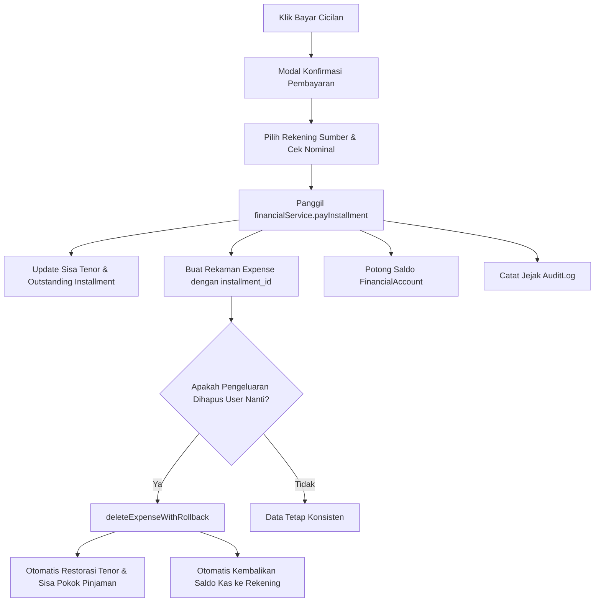

# DOKUMENTASI TEKNIS & SPESIFIKASI FITUR APLIKASI CASHFLOW (v2.0)

Dokumen ini merupakan acuan arsitektur sistem, aturan finansial, skema data, dan flowchart (Mermaid) aplikasi **Cashflow (Family & Personal Finance Management System)** setelah audit dan peningkatan sistem keuangan.

---

## 1. Ringkasan Eksekutif & Karakteristik Aplikasi
* **Nama Projek**: Cashflow (Family & Personal Finance Web App)
* **Tujuan**: Aplikasi pencatatan dan pengelolaan keuangan keluarga secara real-time, bebas dari *double-counting*, pemisahan tegas antara beban konsumsi ekonomi dan arus kas riil, manajemen pinjaman & kartu kredit, proyeksi kas, serta kalender kewajiban finansial.
* **Tech Stack**:
  * **Frontend**: React 19 (TypeScript), Vite 8, React Router DOM v7
  * **State Management**: Zustand v5
  * **Central Service**: `financialService.ts` (Atomic, Idempotent, & Automatic Reversal)
  * **Testing**: Vitest (12 unit test skenario finansial wajib)
  * **Database & Auth**: Firebase Firestore (Realtime `onSnapshot`) + Firebase Authentication (Google Auth dengan Whitelist Email)
  * **Visualisasi & Grafik**: Recharts
  * **Styling**: Vanilla CSS Modular (Dark / Light theme support)

---

## 2. Aturan Bisnis Keuangan (Core Financial Rules)

### A. Cutoff Siklus Finansial (Siklus Gajian Tanggal 25)
* Aplikasi menggunakan tanggal cutoff **25** untuk menentukan periode anggaran bulanan:
  * **Tanggal 1 s.d. 24**: Masuk periode bulan berjalan (`YYYY-MM`).
  * **Tanggal 25 s.d. akhir bulan**: Masuk periode **bulan berikutnya** (`YYYY-(MM+1)`).
  * **Peralihan Desember**: Tanggal 25–31 Desember masuk ke Januari tahun berikutnya (`(YYYY+1)-01`).
  * **Tag 'Semua Bulan'**: Untuk transaksi rutin bulanan yang berlaku di setiap periode filter.

### B. Pemisahan Konsep Finansial (Anti-Double Counting)
1. **Penghasilan Aktual (`Income`)**: Seluruh dana kas/pendapatan yang masuk dalam periode berjalan.
2. **Beban Konsumsi Ekonomi (`Economic Expense`)**: Seluruh nilai barang/jasa yang dikonsumsi (Belanja Tunai + Belanja Kartu Kredit/PayLater).
   * Pembayaran pokok pinjaman **TIDAK** dihitung sebagai beban belanja baru.
   * Pelunasan tagihan kartu kredit **TIDAK** dihitung sebagai belanja baru (karena barang sudah dihitung saat belanja dengan kartu kredit).
3. **Arus Kas Masuk & Keluar (`Cash Inflow & Outflow`)**:
   * `Cash Outflow` = Belanja Kas/Debit + Pembayaran Angsuran Kas + Pelunasan Tagihan Kas.
4. **Perubahan Kas Bersih (`Net Cashflow`)**:
   * $\text{Net Cashflow} = \text{Cash Inflow} - \text{Cash Outflow}$.
5. **Surplus Ekonomi & Saving Rate**:
   * $\text{Economic Surplus} = \text{Income} - \text{Economic Expense}$.
   * $\text{Saving Rate} = (\text{Economic Surplus} / \text{Income}) \times 100\%$ (aman dari pembagian nol).
6. **Total Sisa Utang Pokok (`Outstanding Debt`)**:
   * Sisa pokok pinjaman aktif + tagihan kartu kredit yang belum terbayar.

---

## 3. Skema Data (Data Models)

```typescript
// 1. Akun Keuangan / Sumber Dana (FinancialAccount)
export interface FinancialAccount {
  id: string;
  name: string;              // Contoh: "BCA Tabungan", "Dompet Tunai", "BCA Visa"
  type: 'Cash' | 'Bank' | 'E-Wallet' | 'Credit Card' | 'PayLater' | 'Investment' | 'Other';
  owner: 'Suami' | 'Istri' | 'Bersama';
  currency: string;
  opening_balance: number;
  current_balance: number;   // Saldo kas riil (aset) atau saldo terpakai (kredit)
  credit_limit?: number;
  isActive: number;
  timestamp: number;
}

// 2. Tagihan Kartu Kredit & PayLater (DebtStatement)
export interface DebtStatement {
  id: string;
  debt_account_id: string;   // Nama kartu / relasi
  statement_period: string;  // 'YYYY-MM'
  due_date: string;          // Tanggal jatuh tempo
  closing_balance: number;   // Total tagihan
  minimum_payment: number;
  paid_amount: number;       // Nominal yang sudah dibayar
  status: 'Unpaid' | 'Partially Paid' | 'Paid' | 'Overdue';
}

// 3. Pinjaman & Cicilan (Installment)
export interface Installment {
  id?: string;
  name: string;              // Contoh: "KPR BTN", "Cicilan Motor"
  type: string;
  initial_amount: number;
  monthly_payment: number;
  tenor: number;
  paid_installments: number;
  remaining_installments: number;
  outstanding: number;       // Sisa pokok utang
  due_date: string;
  payment_method: string;
  status: 'Aman' | 'Segera jatuh tempo' | 'Jatuh tempo hari ini' | 'Terlambat' | 'Lunas';
}

// 4. Pengeluaran (Expense)
export interface Expense {
  id?: string;
  date: string;
  category: string;
  payment_method: string;
  amount: number;
  description?: string;
  owner: 'Suami' | 'Istri' | 'Bersama';
  installment_id?: string;
  debt_statement_id?: string;
  source_account_id?: string;
  expense_type?: 'Daily' | 'CreditPurchase' | 'DebtPayment' | 'BillSettlement' | 'FeeOrInterest';
  timestamp: number;
}
```

---

## 4. Mekanisme Transaksi Terpusat (`financialService.ts`)

1. **`payInstallment`**:
   * Memvalidasi sisa tenor pinjaman.
   * Mengurangi sisa tenor dan pokok utang secara konsisten.
   * Menghitung tanggal jatuh tempo bulan berikutnya secara otomatis.
   * Mencatat pengeluaran bertipe `DebtPayment` terhubung `installment_id`.
   * Memotong saldo rekening sumber jika dipilih.
   * Mencatat `AuditLog` dengan status sebelum dan sesudah.
2. **`deleteExpenseWithRollback`**:
   * Jika transaksi yang dihapus merupakan pembayaran cicilan (`installment_id`), sistem secara **otomatis mengembalikan saldo pokok utang dan sisa tenor** ke posisi sebelum pembayaran.
   * Mengembalikan saldo kas ke rekening sumber.
3. **`recordBillSettlement`**:
   * Mencatat pelunasan tagihan kartu kredit/paylater.
   * Mengurangi kewajiban statement tanpa menciptakan beban belanja ganda.
4. **`recordTransfer`**:
   * Memindahkan saldo antarrekening tanpa dicatat sebagai income maupun expense.

---

## 5. Flowchart Sistem

### Alur Pembayaran Cicilan & Proteksi Reversal

